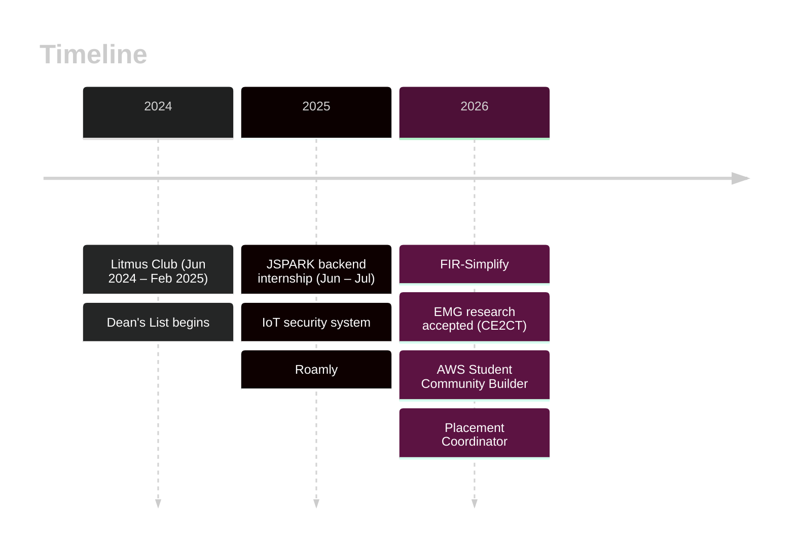
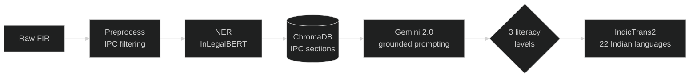
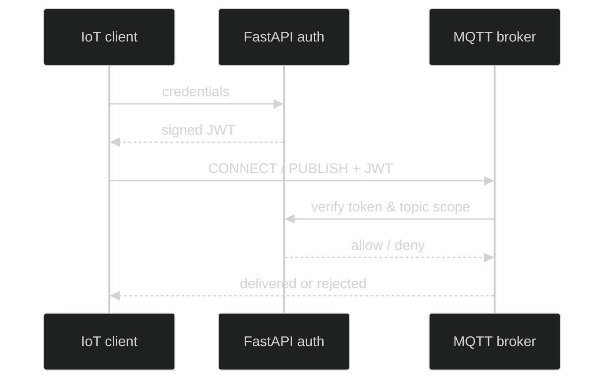
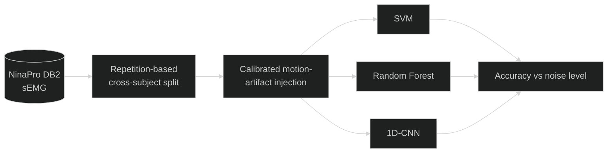

<div align="center">



[+%40+MUJ+%7C+CGPA+9.40;⚙️+Backend+%C2%B7+Distributed+Systems+%C2%B7+AI%2FML;📄+EMG+research+accepted+%40+CE2CT+2026;🧮+400%2B+LeetCode+%7C+C%2B%2B+competitive+programming;🎯+Open+to+SDE+roles)](https://git.io/typing-svg)

[](https://linkedin.com/in/nyshakatiyar)
[](https://github.com/nyshakatiyar)
[](mailto:nyshakatiyar43@gmail.com)
[](https://leetcode.com/u/nyshakatiyar/)

<sub>[**Snapshot**](#-snapshot) · [**Experience**](#-experience) · [**Projects**](#-projects) · [**Research**](#-research) · [**Toolbox**](#-toolbox) · [**Problem solving**](#-problem-solving) · [**Recognition**](#-recognition) · [**Activity**](#-activity)</sub>

</div>

---

## 🧭 Snapshot

<table>
<tr>
<td width="50%" valign="top">

**🎓 Who**
Final-year B.Tech CSE (IoT & Information Security) · Manipal University Jaipur · Batch 2027 · **CGPA 9.40**

**🔍 Looking for**
SDE roles with a backend-first, distributed-systems flavour. Also at home in ML/NLP.

**🧠 How I work**
I like systems where the failure mode is the interesting part: unauthenticated pub/sub, a CNN that collapses on a new subject, an LLM that needs retrieval to stay grounded.

</td>
<td width="50%" valign="top">

**🏆 Highlights**
- 📄 Paper accepted: **CE2CT 2026** (EMG gesture recognition)
- 🏢 Backend intern at **JSPARK** (ISO 27001 / CMMI L3 sovereign-AI startup)
- ☁️ **AWS Student Community Builder** 2026
- 🎖️ **Dean's List**, 4 consecutive semesters
- 🏁 **VibeHack** winner · **IIC 2.0** runner-up
- 🧑‍💼 **Student Placement Coordinator**, MUJ Career Placement Cell
- 🤝 Shortlisted team, **Deloitte USI Capstone Program 2026**

</td>
</tr>
</table>

<div align="center">


</div>

---

## 💼 Experience



| When | Role | What I did |
|:--|:--|:--|
| **Jun – Jul 2025** | **Backend Developer Intern · JSPARK** *(sovereign AI & critical infrastructure, ISO 27001, CMMI L3)* | Designed and deployed **12+ REST APIs** (Node.js · Express · MySQL) in Agile sprints, owning the full request lifecycle through to the DB layer. Cut latency and lifted throughput **~25%** by rewriting slow queries and adding targeted indexes. |
| **Current** | **Student Placement Coordinator · MUJ Career Placement Cell** | Run campus recruitment drives and sit between companies and student applicants. |
| **2026** | **AWS Student Community Builder** | Campus cloud-learning lead: workshops, technical content, community. |
| **Jun 2024 – Feb 2025** | **Promotions & Curation Coordinator · Litmus Club, MUJ** | Led promotions for 10+ events and secured 3 external sponsorships. |

---

## 🏗️ Projects

<details open>
<summary><b>⚖️ FIR-Simplify: making Indian police FIRs readable</b> &nbsp;|&nbsp; <a href="https://github.com/nyshakatiyar">GitHub</a> &nbsp;|&nbsp;  </summary>

<br/>

> *An FIR is written in the language of a court. The person who filed it usually isn't one.*



- **5-stage backend pipeline**: NER → RAG-based IPC retrieval → Gemini 2.0 prompting, so the model rewrites against the *actual* legal sections instead of guessing them.
- **FIR-Corpus-India**: curated **203 FIRs** via the Indian Kanoon API, with automated preprocessing and IPC filtering.
- **Multilingual output** across **22 Indian languages** with IndicTrans2.
- Fine-tuned **InLegalBERT**; shipped as an end-to-end **Gradio** app on **HuggingFace Spaces**.

`Python` `InLegalBERT` `LangChain` `ChromaDB` `Gemini 2.0` `IndicTrans2` `HuggingFace` `Gradio`

</details>

---

<details open>
<summary><b>🔐 Distributed IoT Communication Security</b> &nbsp;|&nbsp; <a href="https://github.com/nyshakatiyar/pns">GitHub</a></summary>

<br/>

> *In MQTT, anyone who can connect can publish. This is what happens when they can't.*



- JWT-based auth layer over a distributed MQTT network, securing **900+ message exchanges per minute** across concurrent clients.
- Blocks unauthorized **publish / subscribe** access in test scenarios.
- Dockerized services and scalable FastAPI endpoints.

`MQTT` `JWT` `FastAPI` `Docker` `Python`

</details>

---

<details open>
<summary><b>🎯 Candidate Discovery Engine: Redrob AI Hackathon, Track 01</b></summary>

<br/>

> *Rank 100,000 candidate profiles against a job description, with no GPU and a limited submission quota.*

- Built a **hybrid scoring pipeline** for intelligent candidate discovery under **CPU-only inference** constraints.
- Designed around the constraint: cheap, fast signals first and a limited number of scored submissions, so every run had to count.

`Python` `Hybrid ranking` `NLP`

</details>

---

<details>
<summary><b>🧩 Natural Language → App Compiler</b></summary>

<br/>

Multi-stage **LLM orchestration** on **FastAPI** that turns a plain-English description into a structured app. Started on Anthropic's API and moved to Google Gemini when credits ran out. Provider-agnostic design paid for itself here.

`FastAPI` `LLM orchestration` `Gemini` `Pydantic`

</details>

---

<details>
<summary><b>📄 Resume Analyzer</b> &nbsp;|&nbsp; </summary>

<br/>

Composite **scoring engine** with radar-chart breakdowns, **keyword-gap analysis** against a target role, and **NER**-based extraction. Deployed on Streamlit Community Cloud.

`Python` `Streamlit` `NER` `Plotly`

</details>

---

<details>
<summary><b>🌍 Roamly: Smart Tourist Safety & Incident Response</b> &nbsp;|&nbsp; <a href="https://github.com/nyshakatiyar/Roamly">GitHub</a></summary>

<br/>

Full-stack **Web3** safety platform: real-time tracking and **geofencing** alerts (Mapbox) for **50+ simulated users**, **Ethereum smart contracts + MetaMask** for decentralized identity, and an SOS dashboard that cut incident-reporting time by **40%** *(measured in simulation)*.

`MongoDB` `Solidity` `Mapbox API` `Tailwind CSS` `MetaMask`

</details>

---

<details>
<summary><b>😊 Facial Emotion Detection</b> &nbsp;|&nbsp; <a href="https://github.com/nyshakatiyar/emotiondetection">GitHub</a></summary>

<br/>

CNNs trained on **FER-2013**, **90%+ accuracy**, with live webcam inference. End-to-end: preprocessing → training → deployment.

`TensorFlow` `Keras` `OpenCV` `CNN` `PCA`

</details>

---

## 🔬 Research

<table>
<tr>
<td valign="top" width="62%">

**Motion Robustness in EMG Gesture Recognition and Wearable E-Tattoo Systems**
*CE2CT 2026 · Paper ID 1371*

Benchmarked a **1D-CNN against SVM and Random Forest** on **NinaPro DB2** under a **repetition-based cross-subject protocol**, with **calibrated motion-artifact injection** to mimic real wearable noise.

</td>
<td align="center" valign="middle">

-58.3%25-brightgreen?style=for-the-badge&labelColor=1e1b4b)
-18.1%25-red?style=for-the-badge&labelColor=1e1b4b)


</td>
</tr>
</table>



> **Finding:** a CNN on raw waveforms looked fine within-subject and **failed to generalize across subjects**; classical models held up better. A negative result, reported as one.

**FIR-Simplify** (legal-domain NLP) is also being written up as a paper.

---

## 🧰 Toolbox

<div align="center">


</div>

```
Languages     Python · C/C++ · Java · JavaScript · SQL · HTML/CSS
Backend       Node.js · Express · FastAPI · REST · JWT auth · MQTT · WebSockets
Cloud & Ops   AWS (EC2, S3) · Azure (basics) · Docker · GitHub Actions · CI/CD
AI / ML       TensorFlow · OpenCV · HuggingFace · LangChain · RAG · ChromaDB · NER · Prompt engineering
Data          MySQL · MongoDB · Firebase
Core CS       DSA · OOP · OS · DBMS · Computer Networks · Distributed Systems
```

---

## 🧮 Problem Solving

- **400+ LeetCode** problems: arrays, graphs, DP, trees, SQL, binary search.
- Competitive programming in **C++** (and PyPy3), with a steady pull toward **graph shortest paths**, **sliding window**, and **binary search on the answer**.
- Comfortable with heavier tools: **Fenwick trees**, **binary lifting**, **offline query processing**.

---

## 🏅 Recognition

| | |
|:-:|:--|
| ☁️ | **AWS Student Community Builder 2026** |
| 🎓 | **Dean's List ×4**: 9.72 · 9.86 · 9.60 · 9.95 *(Aug 2024 – May 2026)* |
| 🏁 | **VibeHack** winner · **IIC 2.0** runner-up |
| 🤝 | **Deloitte USI Capstone Program 2026**: shortlisted team |
| 🧑‍💼 | **Student Placement Coordinator**, MUJ |

**Certifications:** Claude (Anthropic) · AWS Cloud Practitioner · CCNA (Cisco) · Deloitte Data Analytics (Forage) · NPTEL: DSA, Design & Analysis of Algorithms, DBMS · Red Hat Administration · Angular JS & React (Coursera)

---

## 🎓 Education

| Degree | Institution | Period | Score |
|:--|:--|:-:|:-:|
| **B.Tech CSE (IoT & Information Security)** | Manipal University Jaipur | 2023 – 2027 | **9.40 CGPA** |

---

## 📊 Activity

<div align="center">


<br/>


<br/>

<picture>
  <source media="(prefers-color-scheme: dark)" srcset="https://raw.githubusercontent.com/nyshakatiyar/nyshakatiyar/output/github-contribution-grid-snake-dark.svg"/>
  <source media="(prefers-color-scheme: light)" srcset="https://raw.githubusercontent.com/nyshakatiyar/nyshakatiyar/output/github-contribution-grid-snake.svg"/>
  
</picture>

</div>

---

<div align="center">

### 📬 Let's build something that holds up under load

**Open to SDE roles · backend & distributed systems**
[nyshakatiyar43@gmail.com](mailto:nyshakatiyar43@gmail.com) · [LinkedIn](https://linkedin.com/in/nyshakatiyar)


</div>
